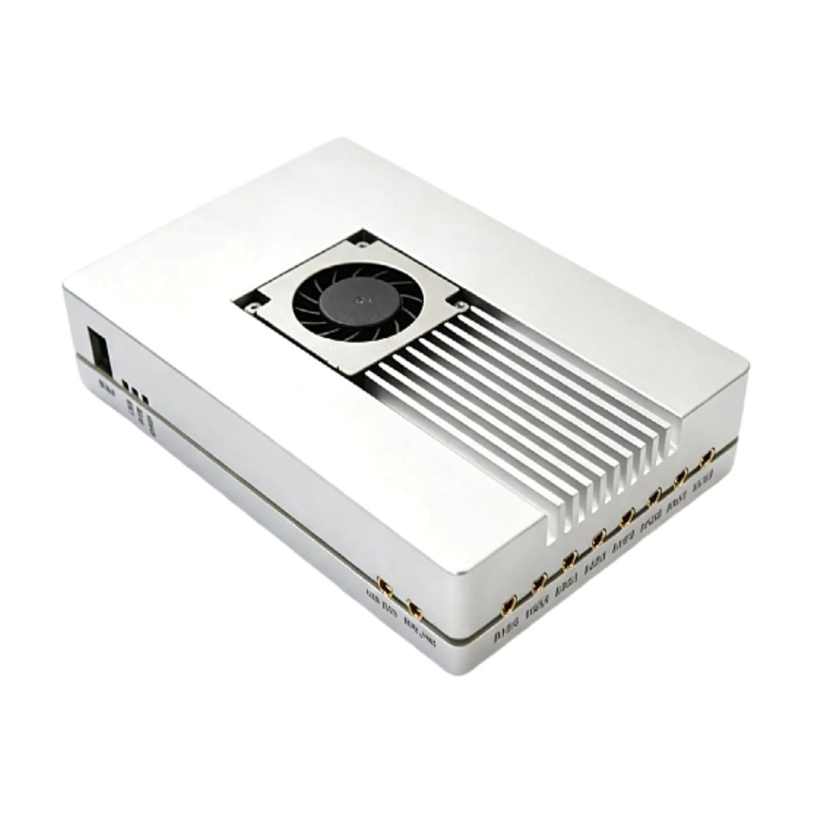
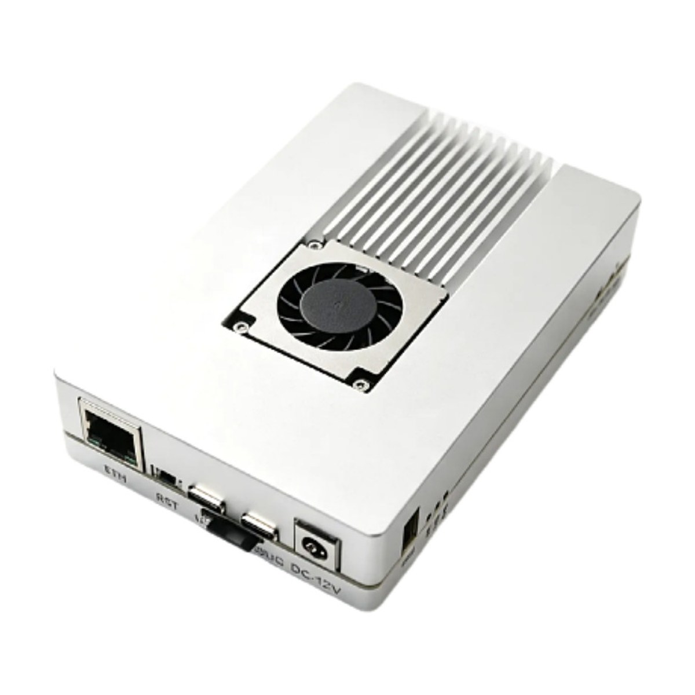

# 7100_2XAD9361

Schematic, Linux (PetaLinux) and bare-metal reference designs and SD-card image for the **OpenSourceSDRLab 7100_2XAD9361**, a stand-alone SDR board that combines a Xilinx Zynq-7000 XC7Z100 SoC with two Analog Devices AD9361 RF transceivers (4 TX + 4 RX, synchronised) in an aluminium case.

  
  

## Product link

<https://opensourcesdrlab.com/products/opensourcesdrlab-high-performance-71002xad9361-board-with-silver-shell>

## About the board

- SoC: Xilinx Zynq-7000 **XC7Z100-2FFG900** (dual Cortex-A9 + Kintex-7-class fabric)
- RF transceivers: two Analog Devices **AD9361** (AD9361BBCZ), 70 MHz – 6 GHz, up to 56 MHz bandwidth; four transmit and four receive channels (TX1/TX2/RX1/RX2 of each chip), synchronised in an FMCOMMS5-style arrangement
- Clocking: shared external LO from an **ADF5355** synthesizer (through an ADCLK925 buffer to both AD9361), 40 MHz VCTCXO locked to a 10 MHz reference by an ADF4001 PLL, ADCLK846 clock fan-out
- Memory: 1 GB DDR3 on the PS, 1 GB DDR3 on the PL, 2 × 32 MB QSPI flash, microSD slot
- Interfaces: Gigabit Ethernet, USB 2.0 (Type-C), combined USB-JTAG/UART debug port (Type-C), GPS module with antenna input, 24 LVDS pairs on an extension connector
- Power: 12 V DC; size 80 × 120 × 26 mm (CNC aluminium case)
- Software: PetaLinux **2022.2** with the Analog Devices Linux kernel (2022_R2) and IIO drivers (FMCOMMS5 configuration); bare-metal designs for Vivado/Vitis **2023.2**

## Quick start

1. Write the SD-card image from the [Releases](../../releases) page to a microSD card.
2. Set the BOOT switch to SD, connect Ethernet, the DEBUG port and 12 V, and power on.
3. Log in on the serial console (115200 8N1) or connect to `192.168.1.10` with IIO Oscilloscope from Analog Devices (FMComms2/3/4/5 plugin).

The full steps are in the **[Quick Start Guide](docs/Quick-Start-Guide.md)** ([PDF](docs/Quick-Start-Guide.pdf)).

## Repository layout

| Path | Contents |
|---|---|
| `hardware/` | Board schematic (PDF) |
| `linux/` | PetaLinux 2022.2 project configuration, board-specific changes to the Analog Devices HDL and Linux kernel (2022_R2), hardware description (`.xsa`) and build instructions |
| `baremetal/FMCOMMS5_PL/` | Vivado 2023.2 project (PL): the Analog Devices `fmcomms5` design adapted to this board (only the changed files; see `baremetal/README.md`) |
| `baremetal/FMCOMMS5_PS/` | Vitis 2023.2 application sources (PS): dual-AD9361 bring-up with the ADF5355 external LO (Analog Devices no-OS), lwIP TCP server, LED, DDR and USB tests, and the hardware platform (`.xsa`) |
| `docs/` | Quick Start Guide (Markdown and PDF) |
| `images/` | Product photos |

## Downloads (Releases)

Large files are attached to the [Releases](../../releases) page instead of being stored in the repository:

| File | Contents |
|---|---|
| `7100_2XAD9361_SD-image_PetaLinux2022.2_120MiB.img.xz` | Complete SD-card image (two partitions, 120 MiB after decompression) |
| `7100_2XAD9361_SD-boot-files_PetaLinux2022.2.zip` | The same boot files and root filesystem as separate files (`BOOT.BIN`, `image.ub`, `boot.scr`, `system.dtb`, `rootfs.tar.gz`) |
| `7100_2XAD9361_FMCOMMS5-baremetal_prebuilt_Vivado2023.2.zip` | Prebuilt bare-metal files: bitstream, `.ltx`, `.xsa`, FSBL and application `.elf` files |
| `SHA256SUMS.txt` | SHA-256 checksums of the files above |

Check a download with `shasum -a 256 -c SHA256SUMS.txt` (macOS / Linux) or `certutil -hashfile <file> SHA256` (Windows).

## Licence

Files created by OpenSourceSDRLab are released under the [Apache License 2.0](LICENSE). Parts of the reference designs come from Analog Devices, Xilinx/AMD and open-source projects (Linux, U-Boot, lwIP) and remain under their own licences; see [NOTICE.md](NOTICE.md).

The SD-card image contains GPL software (Linux kernel, U-Boot, BusyBox and other packages). Where its source code comes from is described in [NOTICE.md](NOTICE.md) and [linux/README.md](linux/README.md); to receive the complete corresponding source code, write to support@opensourcesdrlab.com.

## Support

- Email: support@opensourcesdrlab.com
- Forum: <https://forum.opensourcesdrlab.com>
- Discord: <https://discord.gg/nnxY6DkmvT>
- Blog and user manuals: <https://blog.opensourcesdrlab.com>

---
© 2026 OpenSourceSDRLab. All rights reserved. · <a href="https://www.opensourcesdrlab.com">www.opensourcesdrlab.com</a>
