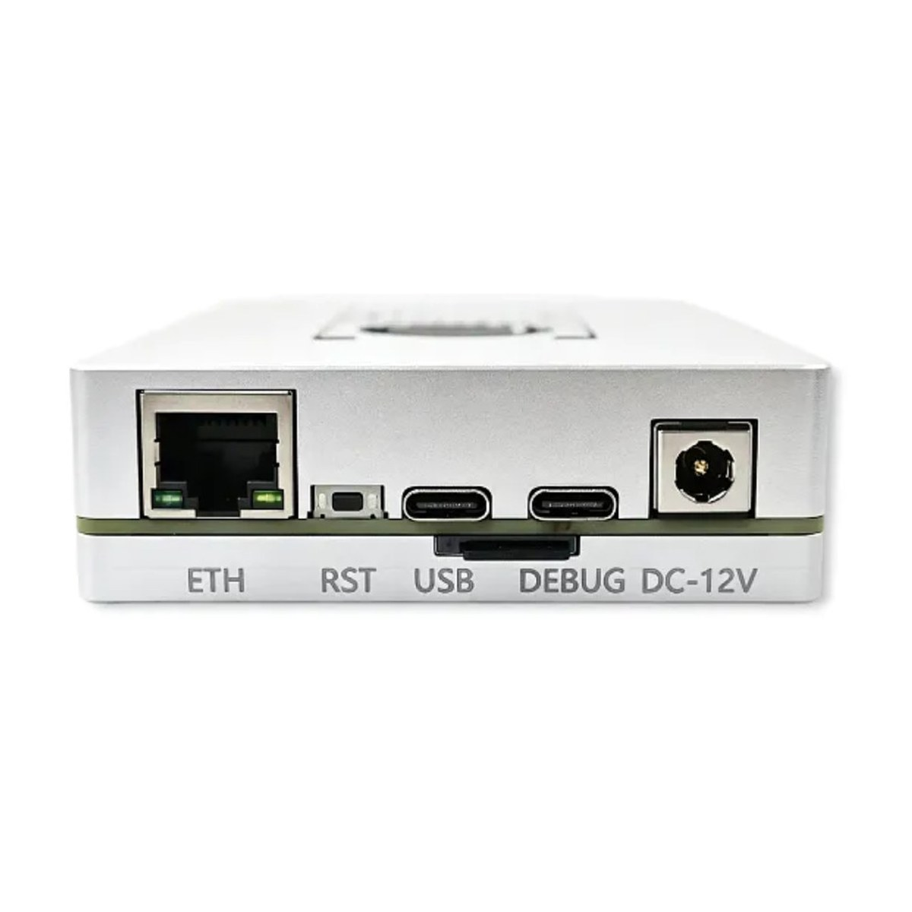

<!-- ossl:header -->

# 7100_2XAD9361 Quick Start Guide

| Product | Document | Version | Date |
|---|---|---|---|
| 7100_2XAD9361 | OSSDRLAB-7100_2XAD9361-QSG | 1.0 | 2026-11-12 |
<!-- /ossl:header -->

## 1. Overview

The 7100_2XAD9361 is a stand-alone software-defined radio built around a Xilinx Zynq-7000 XC7Z100 SoC and two Analog Devices AD9361 RF transceivers. Together the two transceivers provide four transmit and four receive channels that can be synchronised, in the same arrangement as the Analog Devices FMCOMMS5 evaluation board. An on-board ADF5355 synthesizer can drive the local-oscillator inputs of both AD9361, so that all eight channels share one LO.

This guide shows how to boot the board from the prebuilt Linux SD-card image, how to reach the radios over the network, how to use the shared external LO, how to run the bare-metal reference designs, and how to rebuild everything from the sources in this repository.

## 2. What you need

| Item | Notes |
|---|---|
| 7100_2XAD9361 board | with the 12 V power adapter and Ethernet cable from the package |
| microSD card | 1 GB or larger (the image is 120 MiB) |
| USB Type-C cable | for the DEBUG port (serial console and JTAG) |
| PC | Windows or Linux, with an Ethernet port |
| SD-card image | `7100_2XAD9361_SD-image_PetaLinux2022.2_120MiB.img.xz` from the [Releases](../../../releases) page |
| SD-card writing tool | any image writer, for example balenaEtcher or Win32 Disk Imager, or `dd` on Linux |
| Serial terminal | any terminal program (115200 baud, 8 data bits, no parity, 1 stop bit) |
| IIO Oscilloscope (optional) | from Analog Devices: <https://github.com/analogdevicesinc/iio-oscilloscope/releases> |
| Vivado / Vitis 2023.2 (optional) | for the bare-metal designs: <https://www.xilinx.com/support/download.html> |
| PetaLinux 2022.2 on Ubuntu (optional) | to rebuild the Linux image: <https://www.xilinx.com/support/download/index.html/content/xilinx/en/downloadNav/embedded-design-tools.html> |

## 3. Board connectors

| Connector / control | Function |
|---|---|
| TX1, TX2, RX1, RX2 of each AD9361 | eight RF connectors on the front edge: transmit outputs and receive inputs of the first and the second AD9361 |
| LO_IN, RFOUTB | clock / local-oscillator connectors on the side panel (see schematic sheets 17 and 18) |
| GPS antenna | MMCX antenna input of the on-board GPS module |
| ETH | Gigabit Ethernet (PS) |
| USB | USB 2.0 (Type-C, PS) |
| DEBUG | USB-JTAG and USB-UART (Type-C); the serial console is PS UART0 |
| DC-12V | 12 V power input |
| RST | reset button |
| BOOT | boot-mode switch (SD card or QSPI flash) |
| PS_LED | white status LED on PS MIO7; blinks as the Linux heartbeat |

See `hardware/7100_2XAD9361_Schematic.pdf` for the full schematic.

## 4. Boot Linux from the SD card

1. Decompress `7100_2XAD9361_SD-image_PetaLinux2022.2_120MiB.img.xz` (for example with 7-Zip, or `xz -d` on Linux) and write the `.img` file to the microSD card with your SD-card writer. On Linux:

        lsblk                                   # find the SD card, for example /dev/sdb
        sudo umount /dev/sdX* 2>/dev/null || true
        sudo dd if=7100_2XAD9361_SD-image_PetaLinux2022.2_120MiB.img of=/dev/sdX bs=4M conv=fsync
        sync

    Replace `/dev/sdX` with the SD card, never with a system disk.

2. The card now has two partitions: `BOOT` (FAT32, 48 MiB: `BOOT.BIN`, `image.ub`, `boot.scr`, `system.dtb`) and `rootfs` (ext4, the root filesystem).

3. Insert the card, set the BOOT switch to **SD card boot**, connect the Ethernet cable and the DEBUG port to your PC, then connect the 12 V supply.

4. Open the serial port of the DEBUG connector (115200 8N1). FSBL, U-Boot and Linux all print to this console. Log in as `root` with password `root`, and change the password with `passwd` before connecting the board to a shared network.

5. The board's Ethernet address is `192.168.1.10` (gateway `192.168.1.1`). Give your PC an address in the same subnet, for example `192.168.1.100`, and check the link with `ping 192.168.1.10`.

6. The white PS_LED blinks as soon as Linux is running (kernel heartbeat trigger); it does not depend on the radios. The `fmcomms5-heartbeat` service checks both AD9361 and writes their state to the system log. When both radios are ready, `logread | grep fmcomms5-heartbeat` shows `ready: radios=2 ad9361-phy=fdd ad9361-phy-B=fdd`.

> **Tip:** to update only the boot files or the root filesystem, use `7100_2XAD9361_SD-boot-files_PetaLinux2022.2.zip` instead of the whole image: copy `BOOT.BIN`, `image.ub`, `boot.scr` and `system.dtb` to the FAT32 partition, and extract `rootfs.tar.gz` to the ext4 partition with `sudo tar -xpf rootfs.tar.gz -C <mount point>`. To prepare a blank card for this, create a 48 MiB FAT32 partition labelled `BOOT` starting at 1 MiB and an ext4 partition labelled `rootfs` on the rest of the card, for example with `parted`, `mkfs.vfat -F 32 -n BOOT` and `mkfs.ext4 -L rootfs`.

## 5. Use the radios

The Linux image runs the Analog Devices IIO drivers in the FMCOMMS5 configuration and the IIO daemon (`iiod`), so the radios can be used over the network:

1. Start IIO Oscilloscope on the PC and connect to `ip:192.168.1.10`.
2. Open the AD9361 plugin (FMComms2/3/4/5). Both transceivers appear: `ad9361-phy` (first AD9361) and `ad9361-phy-B` (second AD9361).
3. Set the LO frequencies, gains and the transmit waveform, and watch the received spectrum on the capture window.

Any software that uses libiio (GNU Radio IIO blocks, MATLAB, Python `pyadi-iio` with the FMCOMMS5 class) can connect to the same address.

### 5.1 Shared external LO (ADF5355)

The board's ADF5355 synthesizer (schematic sheet 18, IC17) feeds the TX and RX `EXT_LO_IN` pins of both AD9361 from its RFOUTA output, through a matching network and an ADCLK925 buffer. RFOUTB is not used and stays off.

- The device tree enables RFOUTA with `adi,clock-shift = <2>`. At power-up the ADF5355 outputs 4.8 GHz, which gives an LO of 2.4 GHz on both AD9361 (`EXT_LO_IN` = 2 × LO).
- The RFOUTA enable pin (net `5355_RF_EN`, FPGA pin AE20, EMIO GPIO 57) is driven by the kernel driver and follows the `out_altvoltage0_powerdown` attribute of the ADF5355, so the external LO can be switched on and off from IIO Oscilloscope (0 = output on, 1 = off).
- Both AD9361 share the same external LO: changing the LO frequency of one chip changes it for both.
- To set the LO, enter the frequency in the RX LO / TX LO fields of the AD9361 plugin, for example 2400000000 Hz. The same from the board's command line (first chip):

        iio_attr -c ad9361-phy altvoltage0 frequency 2400000000   # RX LO
        iio_attr -c ad9361-phy altvoltage1 frequency 2400000000   # TX LO

## 6. Bare-metal reference designs

The bare-metal designs use the same board without Linux. The prebuilt files are in `7100_2XAD9361_FMCOMMS5-baremetal_prebuilt_Vivado2023.2.zip` on the [Releases](../../../releases) page.

| File | What it does |
|---|---|
| `FMCOMMS5.elf` | Initialises both AD9361 (Analog Devices no-OS driver, FMCOMMS5 mode; ADF5355 external LO support), transmits a sine wave from all four TX channels through DMA and prints captured samples of the four RX channels on the serial console |
| `TCP_Server.elf` | lwIP TCP server for throughput tests, for example with `iperf -c 192.168.1.10 -i 5 -t 300 -w 2M` |
| `LED.elf` | blinks the PS LED |
| `DDR_Test.elf` | PS DDR3 memory test |
| `xusbps_intr_example_1.elf` | USB 2.0 device example (mass storage) |

To run an application over JTAG:

1. Connect the DEBUG port and power the board. In Vivado Hardware Manager the XC7Z100 appears on the USB-JTAG cable.
2. In Vitis 2023.2, create a platform from `system_top.xsa`, then use **Run As > Launch Hardware**, or program `system_top.bit` and download the `.elf` with XSCT.
3. Watch the output on the serial console (115200 8N1).

To boot a bare-metal application from the SD card, create `BOOT.bin` with bootgen from `fsbl.elf`, the bitstream and the application `.elf`, and copy it to a FAT32-formatted card.

## 7. Rebuild from source

### 7.1 Linux image (PetaLinux 2022.2)

The `linux/` folder holds the board-specific part of the PetaLinux project. The full steps, including which upstream Analog Devices sources to combine it with, are in `linux/README.md`. In short:

1. On Ubuntu with PetaLinux 2022.2 installed, assemble the project tree as described in `linux/README.md` (Analog Devices `hdl`, `linux` and `meta-adi` at release 2022_R2 plus the files and patch from this repository), then run `bash prepare.sh` once (again whenever the folder moves).

2. Load the PetaLinux environment (use your own installation path):

        source <petalinux-2022.2-install-dir>/settings.sh

3. Import the hardware description and the root-filesystem configuration, then build:

        cd petalinux
        petalinux-config --get-hw-description=../hardware --silentconfig
        petalinux-config -c rootfs --silentconfig
        petalinux-build

    The first build downloads the Yocto sources. On a machine without Internet access, prepare a `downloads` folder and point `CONFIG_PRE_MIRROR_URL` in `project-spec/configs/config` to it.

4. Create `BOOT.BIN`:

        petalinux-package --boot --fsbl images/linux/zynq_fsbl.elf --fpga images/linux/system.bit \
          --u-boot images/linux/u-boot.elf --dtb images/linux/system.dtb --force

5. Copy `BOOT.BIN`, `image.ub`, `boot.scr` and `system.dtb` from `petalinux/images/linux/` to the FAT32 partition and extract `rootfs.tar.gz` to the ext4 partition (see the tip in section 4).

`linux/hardware/system_top.xsa` is the prebuilt hardware description (PS configuration and the interface logic of both AD9361; the PL DDR3 is not used by the Linux design). Rebuild it with Vivado 2022.2 only if you change the HDL in `linux/hdl/`.

### 7.2 Bare-metal designs (Vivado / Vitis 2023.2)

1. Prepare the Vivado project as described in `baremetal/README.md`: clone the Analog Devices HDL repository at the tested commit, copy `baremetal/FMCOMMS5_PL/` over it, and build the Analog Devices IP libraries that the design uses.

2. Open `projects/fmcomms5/zc706/fmcomms5_zc706.xpr` in Vivado 2023.2, generate the bitstream and export the hardware (`.xsa`). A ready-made `.xsa` is in `baremetal/FMCOMMS5_PS/`.

3. In Vitis 2023.2, create a platform from the `.xsa` (standalone, `ps7_cortexa9_0`; add the `lwip213` library for `TCP_Server`), then an empty bare-metal C application for each folder in `baremetal/FMCOMMS5_PS/`, and import its sources. For `FMCOMMS5`, import the folders `ad9361`, `api`, `axi_core`, `iio`, `include`, `src`, `util` and `xilinx`, and add each of them (and `iio/iio_app`) to the include directories (ARM v7 gcc compiler > Directories).

4. Build the application, then run it over JTAG or create `BOOT.bin` as in section 6.

## 8. Support

- Product page: <https://opensourcesdrlab.com/products/opensourcesdrlab-high-performance-71002xad9361-board-with-silver-shell>
- Email: support@opensourcesdrlab.com
- Forum: <https://forum.opensourcesdrlab.com>
- Discord: <https://discord.gg/nnxY6DkmvT>

<!-- ossl:footer -->
---
© 2026 OpenSourceSDRLab. All rights reserved. · <a href="https://www.opensourcesdrlab.com">www.opensourcesdrlab.com</a>
<!-- /ossl:footer -->
